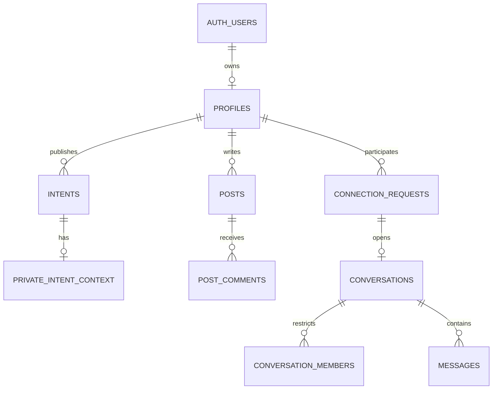

# Telos database

The database source is versioned here. The SQL migrations define the schema, constraints, indexes, row-level security, database functions, triggers, Storage policies and Realtime publication changes. No live user records or credentials are included.

## Recreate the database

1. Create a separate Supabase project for review or testing.
2. Run every SQL file in [migrations](migrations/) in filename order, from `202611030001_telos.sql` through `202611080010_volunteers_and_save_identity.sql`, once each. These ten files together define the current database. Run only pending files on an existing database.
3. Configure local variables using [../.env.example](../.env.example). Follow [../AUTH_SETUP.md](../AUTH_SETUP.md) for email/Google sign-in and [../DEPLOYMENT.md](../DEPLOYMENT.md) for hosting.
4. Optionally run `npm.cmd run seed:demo` from the repository root to create fictional, offline demo content. See [../DEMO_INTENTS.md](../DEMO_INTENTS.md). The seed requires your own project's administrator key at a hidden local prompt.

Supabase manages the `auth` and `storage` service schemas; the migrations configure the app's integration with them. SMTP credentials, Google OAuth credentials, redirect settings and Gemini keys are configured separately and are not database source files.

## Schema overview

| Area | Main tables | Purpose |
| --- | --- | --- |
| Accounts | `auth.users`, `public.profiles` | Login identities and optional profile details; demo markers identify fictional accounts. |
| Discovery | `public.intents`, `private.intent_context` | Active/saved intentions, private coordinates and 768-dimensional embeddings. |
| Matching state | `private.search_sessions`, `private.search_generations`, `private.intent_request_keys` | Ordered requests and reuse of equivalent submissions. |
| AI cache | `private.intent_artifacts`, `private.match_reviews` | Owner-scoped derived artifacts and contextual pair decisions. |
| Relationships | `public.connection_requests`, `public.follows`, `public.blocks`, `private.request_context` | Invitations, following, blocking and private invitation context. |
| Chat | `public.conversations`, `public.conversation_members`, `public.messages` | Member-restricted chat history and per-conversation read cursors. |
| Feed | `public.posts`, `public.post_likes`, `public.post_comments`, `public.post_saves` | Independent social posts and interactions. |
| Presence/activity | `public.member_presence`, `private.presence_sessions`, event tables | Presence expiry and Realtime invalidations. |
| Operations | `public.notifications`, `public.reports`, `private.rate_limits` | Connection alerts, reports and limits. |
| Uploads | Supabase Storage: `profile-media`, `post-media` | Profile media and access-controlled post photos. |

RLS and database functions enforce access; the browser does not receive private coordinates or vectors. Qualified matching results include the selected intent text so people can understand the match. Messages use membership access controls, not end-to-end encryption. See [../MATCHING.md](../MATCHING.md) for the matching pipeline and test boundaries.

## Administrator files

[admin](admin/) contains one-time reset tools, **not installation migrations**. `preview_non_demo_reset.sql` only reports reset scope. `reset_non_demo.sql` permanently deletes non-demo logins and app data while preserving demo accounts and their posts/intents. Do not run the reset as part of project setup.

## Verification

`npm.cmd test -- tests/database.test.ts tests/migration.test.ts` runs migrations and database checks locally using PostgreSQL, PostGIS and pgvector through PGlite. Cloud Auth, Storage delivery and Realtime still require a separate Supabase integration test.
